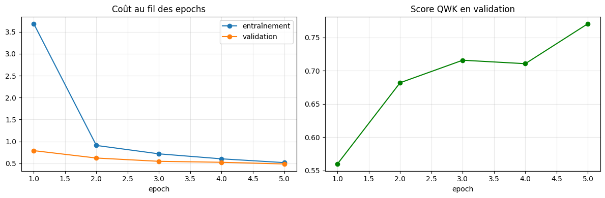
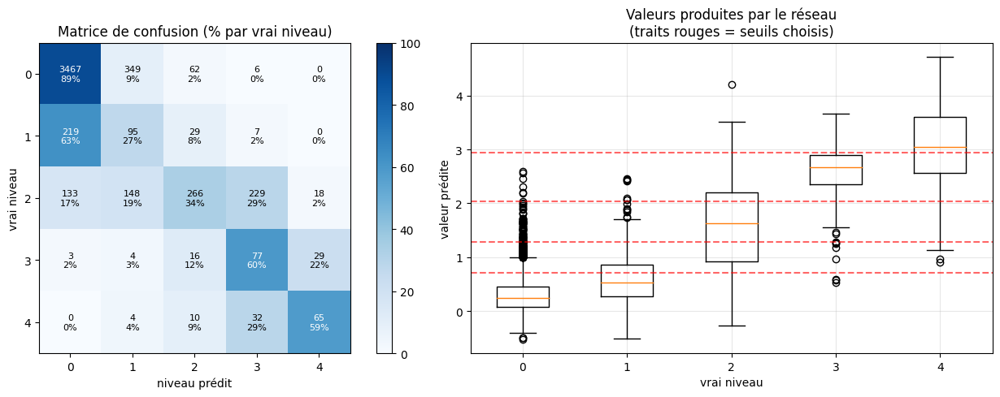

# Diabetic Retinopathy Detection — Deep Learning

> 🇫🇷 **Résumé** — Classification de 35 126 photographies de fond d'œil selon 5 niveaux de gravité de la rétinopathie diabétique, par fine-tuning d'un EfficientNet-B3 (PyTorch). Découpage entraînement/validation par patient pour éviter toute fuite, pondération des classes rares, optimisation des seuils de décision. **Score Kaggle : 0,79 (QWK)**, au niveau du top 10 sur 661 équipes du classement final (soumission après clôture). Projet de groupe, Master 2 TIDE, Université Paris 1 Panthéon-Sorbonne.

Grading the severity of diabetic retinopathy from retinal fundus photographs, on the [Kaggle Diabetic Retinopathy Detection](https://www.kaggle.com/competitions/diabetic-retinopathy-detection) challenge.

| | |
|---|---|
| **Task** | 5-level ordinal classification (0 = no DR → 4 = proliferative DR) |
| **Data** | 35,126 training images from 17,563 patients, 53,576 test images |
| **Model** | EfficientNet-B3 (ImageNet / Noisy Student weights), fine-tuned as a regression head |
| **Metric** | Quadratic Weighted Kappa (QWK), the official competition metric |
| **Result** | **Kaggle private score 0.79** — on par with the top 10 of 661 teams on the final leaderboard |
| **Stack** | Python, PyTorch, timm, Albumentations, OpenCV, scikit-learn, SciPy |

## Approach

1. **Fast image loading** — JPEG decoded directly at quarter resolution (4× faster), black border cropped, image squared and resized to 448×448 px.
2. **Leakage-free split** — the two eyes of a patient are highly similar, so the train/validation split is done **by patient** (85 % / 15 %), with 0 patient on both sides.
3. **Class imbalance** — 73 % of images are healthy. Each class is weighted by the square root of its inverse frequency (the rarest class weighs 6.1× the most frequent).
4. **Model** — EfficientNet-B3 with a single output (regression on the severity level), dropout 0.3, AdamW, OneCycle learning-rate schedule, mixed precision.
5. **Augmentation** — flips, rotations, zoom, brightness/contrast; test-time augmentation on 2 views.
6. **Threshold optimisation** — the continuous output is cut into 5 levels with thresholds optimised directly for QWK (Nelder–Mead), instead of plain rounding.

## Results

| Epoch | Train loss | Validation loss | Validation QWK |
|---|---|---|---|
| 1 | 3.687 | 0.790 | 0.560 |
| 2 | 0.909 | 0.622 | 0.682 |
| 3 | 0.717 | 0.547 | 0.716 |
| 4 | 0.603 | 0.524 | 0.710 |
| 5 | 0.517 | 0.487 | **0.771** |

- Threshold optimisation raises validation QWK from **0.771 to 0.800** (+0.030).
- **Kaggle private score: 0.79**, close to validation — the patient-level split gives a well-calibrated estimate.
- Validation accuracy: 75.4 %. Recall is highest on healthy eyes (89 %) and severe stages (60 % for level 3, 59 % for level 4); mild DR (level 1) remains the hardest class, as in the original competition.





**Next steps identified:** validation QWK was still rising at epoch 5, so training longer (10 epochs), a higher resolution (512 px, micro-aneurysms are only a few pixels wide) and combining both eyes of the same patient (87 % share the same level) are expected to reach 0.81–0.84.

## Repository structure

```
├── notebooks/
│   └── diabetic_retinopathy_efficientnet.ipynb   # full pipeline, executed on Kaggle (comments in French)
├── images/                                       # figures produced by the notebook
├── requirements.txt
└── README.md
```

## How to run

The training set weighs 36 GB, so the notebook is designed to run **on Kaggle** with a GPU:

1. Create a notebook from the competition's *Code* tab and import `diabetic_retinopathy_efficientnet.ipynb`.
2. Attach the unzipped image datasets (`diabetic-retinopathy-train-unzipped`, `diabetic-retinopathy-test-unzipped`).
3. Select a **GPU P100** accelerator, then *Save & Run All*.
4. Submit the generated `submission.csv` from the *Output* tab (about 2 hours end-to-end; set `NB_IMAGES_TEST = 5000` for a 10-minute trial run).

The data is not included in this repository: it is subject to the Kaggle competition rules.

## Context

Team project — Deep Learning course (J. Rynkiewicz), Master 2 TIDE (*Traitement de l'Information et Data Science en Entreprise*), Université Paris 1 Panthéon-Sorbonne, 2025–2026.
